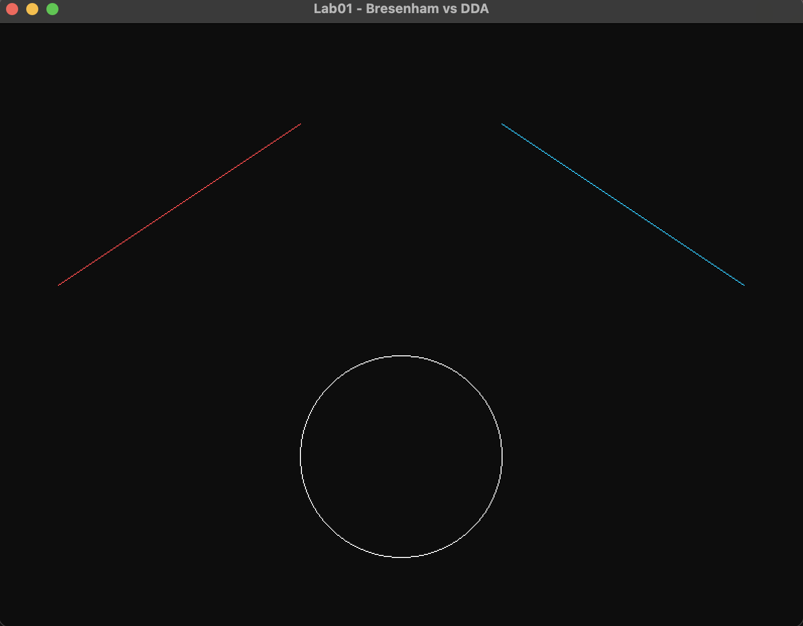
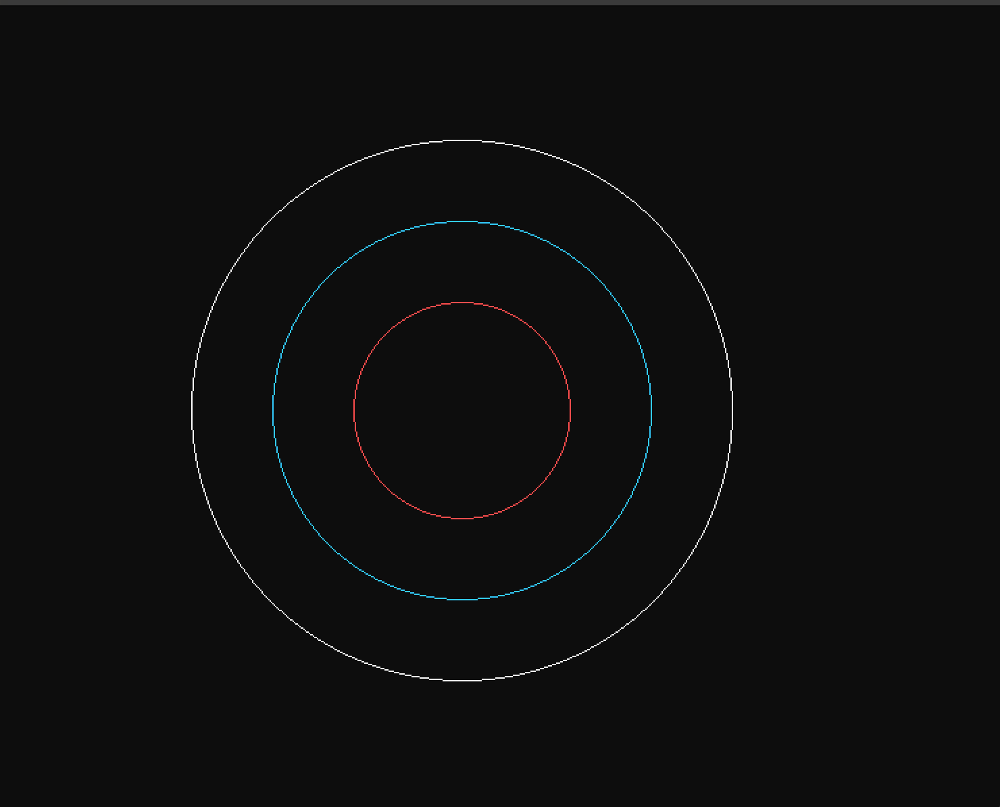
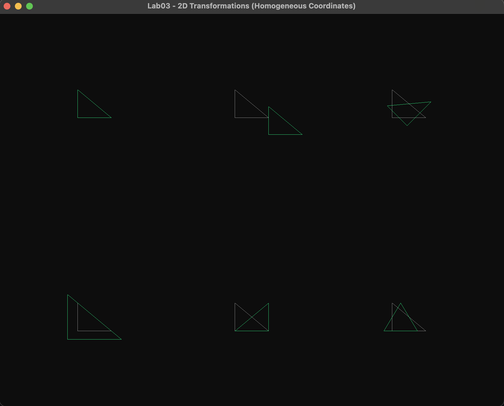
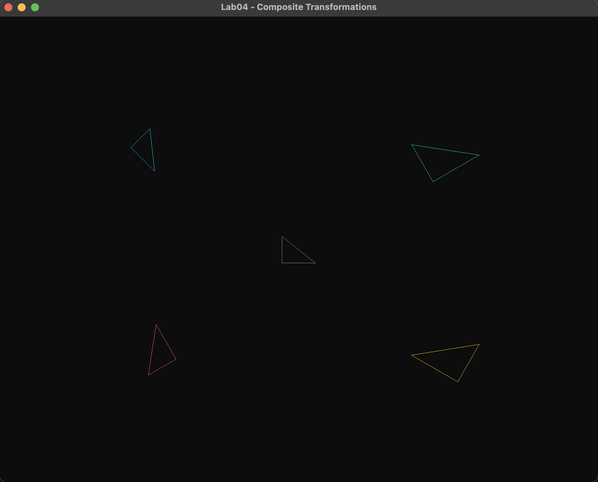
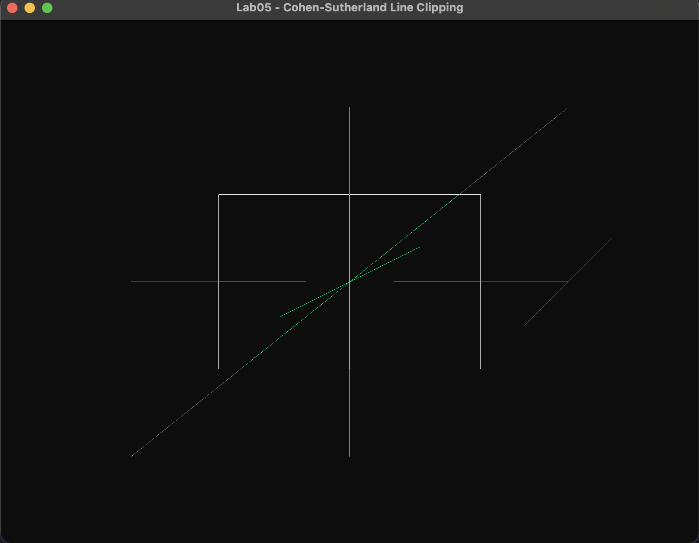

# CG_VR — Computer Graphics and Virtual Reality (CS4104)

Lab programs for the Computer Graphics and Virtual Reality course, implemented in C++ with OpenGL (GLFW + glad).

## Build & run

Each lab is a separate executable target, auto-discovered by CMake from `labs/*`.

```sh
cmake -S . -B out/build/default
cmake --build out/build/default --target Lab01   # or Lab02, Lab03, ...
```

Or use the convenience scripts from the repo root, which build and launch a lab in one step:

```sh
./lab01   # Lab01
./lab02   # Lab02
...
./lab08   # Lab08
```

Each running window closes with `Esc` or the window close button.

## Labs

| # | Title | Algorithm(s) | Source | Screenshot |
|---|-------|--------------|--------|------------|
| 01 | Line Drawing | Bresenham's line algorithm, DDA line algorithm, Midpoint circle algorithm | [labs/Lab01](labs/Lab01) |  |
| 02 | Midpoint Circle Drawing | Midpoint circle algorithm (three concentric circles) | [labs/Lab02](labs/Lab02) |  |
| 03 | 2D Transformations | Translation, rotation, scaling, reflection, shearing via homogeneous coordinates | [labs/Lab03](labs/Lab03) |  |
| 04 | Composite Transformations | Matrix composition (M = T·R·S) applied in a single multiply, verified against sequential application | [labs/Lab04](labs/Lab04) |  |
| 05 | Line Clipping | Cohen–Sutherland line clipping algorithm | [labs/Lab05](labs/Lab05) |  |

Labs 06–08 are not yet implemented.

## Branches

Each lab was also developed on its own branch (`lab1`, `lab2`, ... `lab5`) as a running lab record; `main` carries the merged, current state of every completed lab shown in the table above.
